# ⚔️ Guerreiros do Reino

> *A Queda das Hordas Goblins*: um jogo 2D de ação e plataforma com tema medieval sombrio, feito em **Godot 4.7**.

O reino de Vale Dourado foi tomado por hordas de goblins, um Minotauro furioso e o temido **Cérbero**, guardião do abismo, que roubou o trono do Rei. Escolha um dos três guerreiros e atravesse a aldeia em chamas, as muralhas sob tempestade e as masmorras do castelo para libertar o reino.

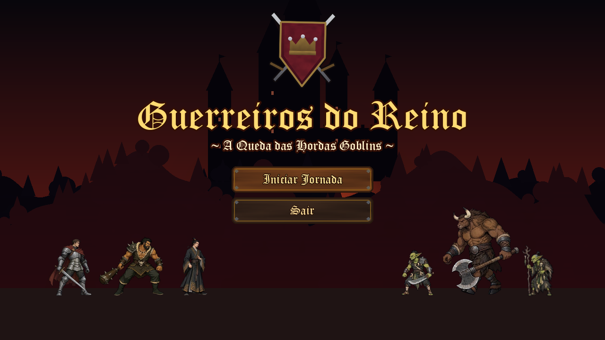

---

## 📑 Sumário
- [Como rodar](#-como-rodar)
- [Controles](#-controles)
- [Os guerreiros](#-os-guerreiros)
- [As fases](#-as-fases)
- [Inimigos e chefes](#-inimigos-e-chefes)
- [Mecânicas](#-mecânicas)
- [Direção de arte](#-direção-de-arte)
- [Estrutura do projeto](#-estrutura-do-projeto)
- [Level design no editor](#-level-design-no-editor)
- [Ferramentas de geração (pipeline)](#-ferramentas-de-geração-pipeline)
- [Modo de captura (debug)](#-modo-de-captura-debug)
- [Limitações conhecidas](#-limitações-conhecidas)

---

## ▶️ Como rodar

1. Abra o **Godot 4.7.2** (`Godot_v4.7.2-stable_win64.exe`).
2. Em *Importar*, selecione o arquivo `project.godot` desta pasta.
3. Aperte **F5** (ou o botão ▶) para jogar.

Na primeira abertura o Godot importa as texturas. Isso leva alguns segundos.

Para rodar pela linha de comando:
```bash
Godot_v4.7.2-stable_win64.exe --path C:\Users\acssantos\Documents\warriors
```

---

## 🎮 Controles

| Ação | Teclado | Controle |
|---|---|---|
| Mover | `A` / `D` ou `←` / `→` | D-pad / analógico esquerdo |
| Pular | `Espaço` ou `K` | **A** |
| Atacar | `J` ou `Z` | **X** |
| Especial | `L` ou `X` | **Y** |
| Pausar | `Esc` ou `P` | **Start** |
| Confirmar (menus) | `Enter` / `Espaço` / `J` | **A** |

O pulo tem altura variável: soltar o botão cedo dá um pulo mais baixo. Também há *coyote time* (dá para pular logo depois de sair de uma beirada) e *buffer* de pulo (o comando fica guardado se for apertado um pouco antes de tocar o chão).

---

## 🛡️ Os guerreiros

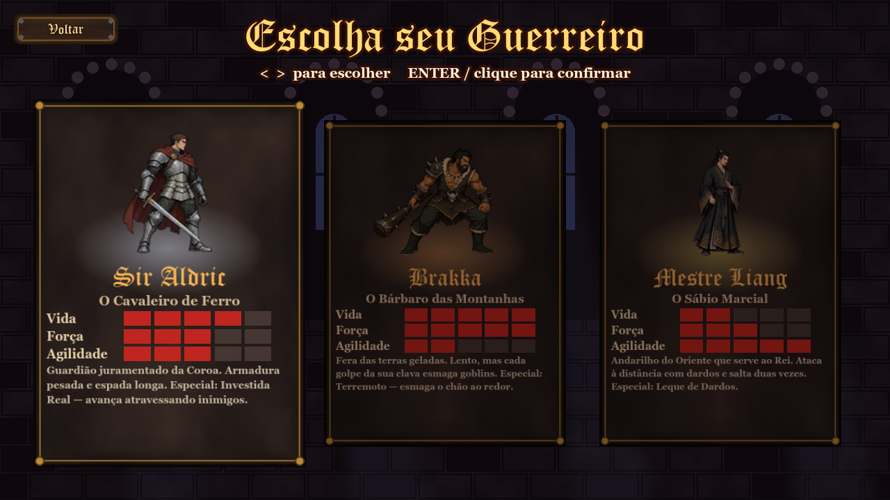

| | **Sir Aldric**, o Cavaleiro de Ferro | **Brakka**, o Bárbaro das Montanhas | **Mestre Liang**, o Sábio Marcial |
|---|---|---|---|
| Estilo | Equilibrado, corpo a corpo | Tanque, dano alto | Ataque à distância, ágil |
| Vida | 150 | 200 | 110 |
| Velocidade | 280 | 240 | 310 |
| Dano por golpe | 26 | 40 | 18 por dardo |
| Ataque | Combo de 2 cortes de espada (descendente e ascendente) | Golpe horizontal de clava, com área maior | Arremessa um dardo |
| **Especial** | **Investida Real**: avança atravessando os inimigos, invulnerável, com 1,5× de dano | **Terremoto**: golpe no chão com onda de choque, 1,6× de dano em área e arremessa os inimigos | **Leque de Dardos**: 5 dardos em leque |
| Recarga do especial | 2,2 s | 3,5 s | 2,0 s |
| Extra | — | — | **Pulo duplo** |

A barra dourada abaixo da vida mostra a recarga do especial.

---

## 🗺️ As fases

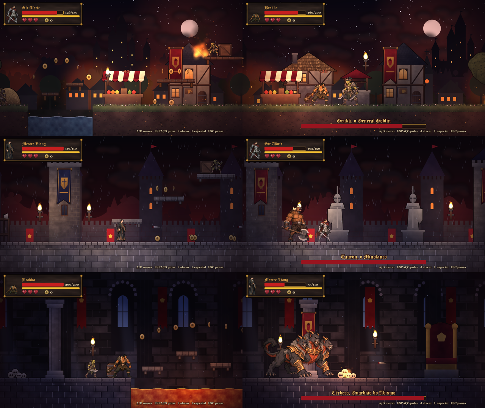

### 1. Aldeia em Chamas 🔥
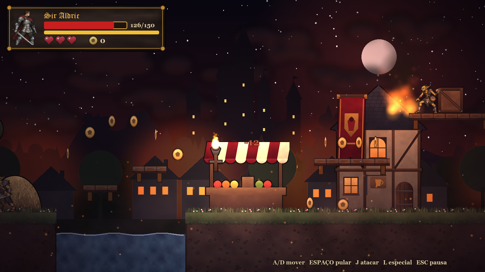

Noite de lua de sangue. Os goblins incendeiam Vale Dourado.
- **Clima:** brasas e cinzas no ar, casas pegando fogo, névoa rasteira.
- **Percurso:** entrada da aldeia, fosso com água (ponte de tábuas), mercado com plataformas sobre os telhados, colina do moinho (terreno elevado), abismo de espinhos e rua das casas.
- **Inimigos:** goblins guerreiros, lanceiros, boleadeiros nos telhados e xamã.
- **Chefe:** **Grukk, o General Goblin**, na praça da aldeia.

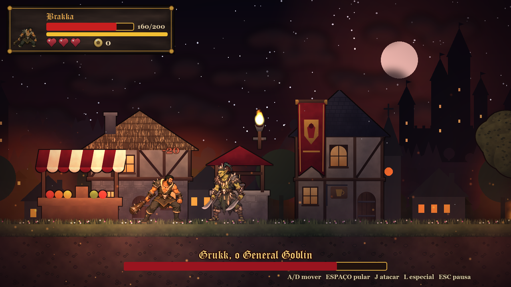

### 2. Muralhas de Pedraforte ⛈️
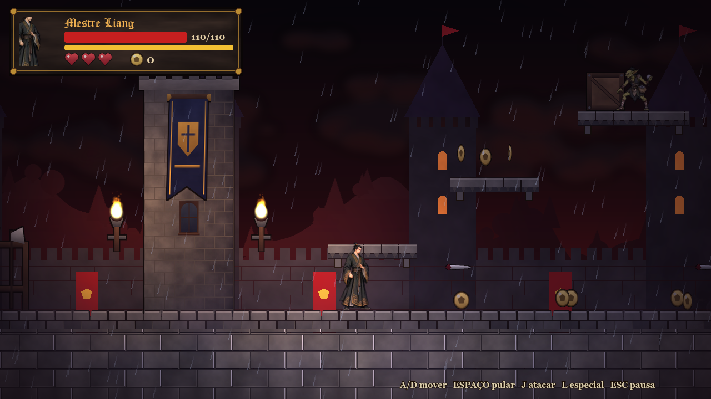

As hordas cercam o castelo debaixo de uma tempestade.
- **Clima:** chuva, relâmpagos que iluminam a tela e trovões.
- **Percurso:** ponte levadiça sobre o fosso, pátio externo com escadarias de pedra até o topo de uma torre, caminho alto da muralha com buraco de espinhos, fosso interno e pátio interno.
- **Inimigos:** xamãs, boleadeiros no alto das escadas, lanceiros e guerreiros.
- **Chefe:** **Tauron, o Minotauro**, no pátio interno, entre estátuas de cavaleiros.

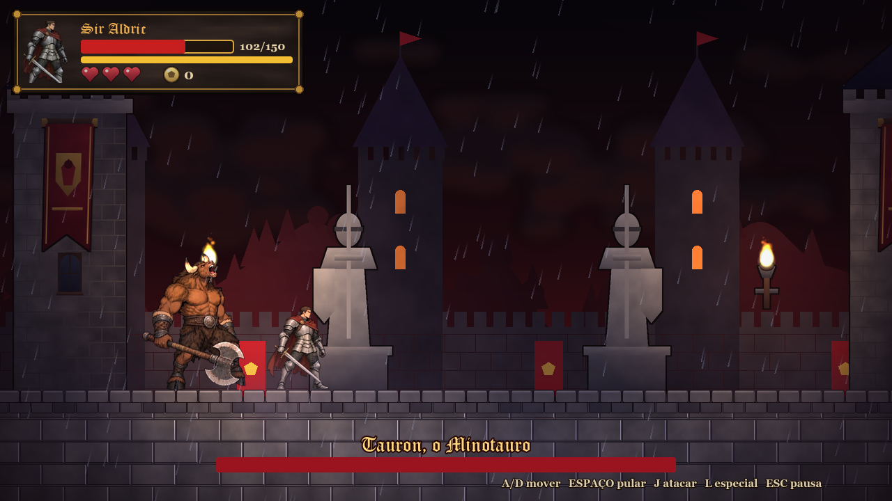

### 3. Masmorras do Trono 🕯️
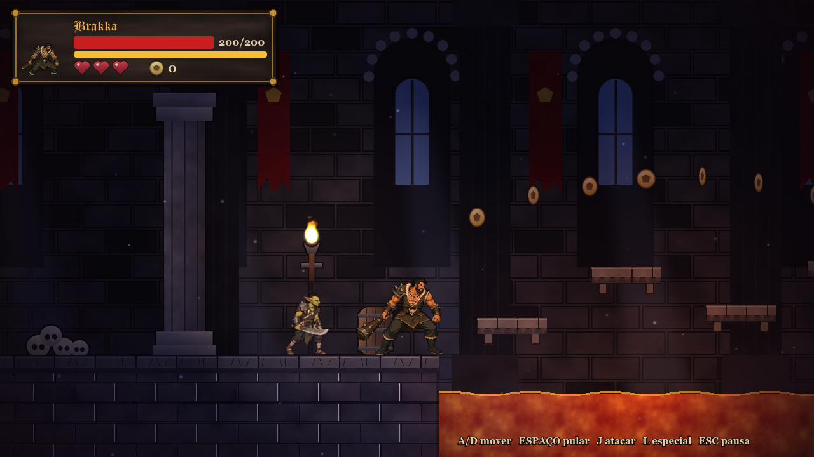

Escuridão quase total, iluminada só por tochas e rios de lava.
- **Clima:** poeira flutuando, luar azulado pelas janelas, luz quente das tochas e da lava.
- **Percurso:** entrada com correntes e caveiras, rio de lava atravessado por plataformas de pedra, salão de armas, corredor de espinhos, poço de lava com subida e sala do trono.
- **Chefe final:** **Cérbero, Guardião do Abismo**, diante do trono roubado.

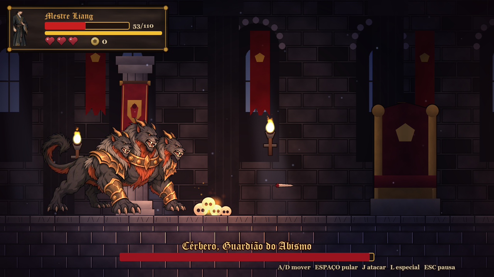

---

## 👹 Inimigos e chefes

| Inimigo | Vida | Comportamento |
|---|---|---|
| **Goblin Guerreiro** | 50 | Patrulha, avista o herói (mostra um "!"), persegue e ataca com a cimitarra. |
| **Goblin Lanceiro** | 65 | Golpe de lança de longo alcance. **Bloqueia 35% dos golpes frontais** (faísca + "Bloqueou!"). Ataque-o pelas costas. |
| **Goblin Boleadeiro** | 35 | Fica parado em pontos altos e arremessa boleadeiras em arco, calculando a trajetória até você. |
| **Goblin Xamã** | 50 | Mantém distância (recua se você se aproxima) e lança orbes mágicos mirados na sua posição. |

| Chefe | Vida | Padrões de ataque |
|---|---|---|
| **Grukk, o General Goblin** | 420 | Combos de cimitarras duplas e **saltos** sobre o herói, que criam ondas de choque no chão. Com menos de 50% de vida, **chama reforços** e fica mais agressivo. |
| **Tauron, o Minotauro** | 650 | Avança **rolando** em alta velocidade (dano alto, pule por cima!) e **pisa no chão**, soltando ondas de choque para os dois lados. Com menos de 50% de vida, entra em **FÚRIA**: mais rápido e ataques mais frequentes. |
| **Cérbero** | 950 | **Sopra fogo** com as três cabeças (3 bolas de fogo), faz **chover fogo** do teto e dá **botes** pela arena, com impacto e ondas de choque. Na segunda fase invoca goblins e acelera todos os padrões. |

Ao entrar na arena, a câmera trava, paredes invisíveis fecham a saída, a música muda e aparece a barra de vida do chefe. Quando o chefe cai, o portão de saída abre (aparece uma seta "SAÍDA >>").

---

## ⚙️ Mecânicas

- **Vidas:** você começa com 3 (corações no HUD). Ao morrer, a fase recomeça da última bandeira.
- **Bandeiras do Reino (checkpoints):** ao tocar, a bandeira se ergue, vira o ponto de renascimento e cura 25 de vida.
- **Ouro:** moedas espalhadas pela fase, em arcos que indicam o caminho dos pulos, ou deixadas pelos inimigos.
- **Poções:** curam 45 de vida. Caem de inimigos (15%), de chefes (100%) e de caixas.
- **Caixotes e barris:** quebram com golpes e soltam moedas ou poções. Servem também de plataforma.
- **Perigos:** água, lava e espinhos tiram 30 de vida e devolvem você ao último chão seguro. O mesmo vale para quedas em abismos.
- **Sensação de impacto:** *hitstop* (pausa curta no acerto), tremor de câmera, números de dano flutuantes, faíscas, poeira e piscar de invulnerabilidade.
- **Pausa:** continuar, reiniciar a fase ou voltar ao menu.
- **Fim de jogo:** tela de derrota (*Fim da Jornada*) com opção de tentar de novo a mesma fase, e tela de vitória ao derrotar Cérbero.

| Derrota | Vitória |
|---|---|
| 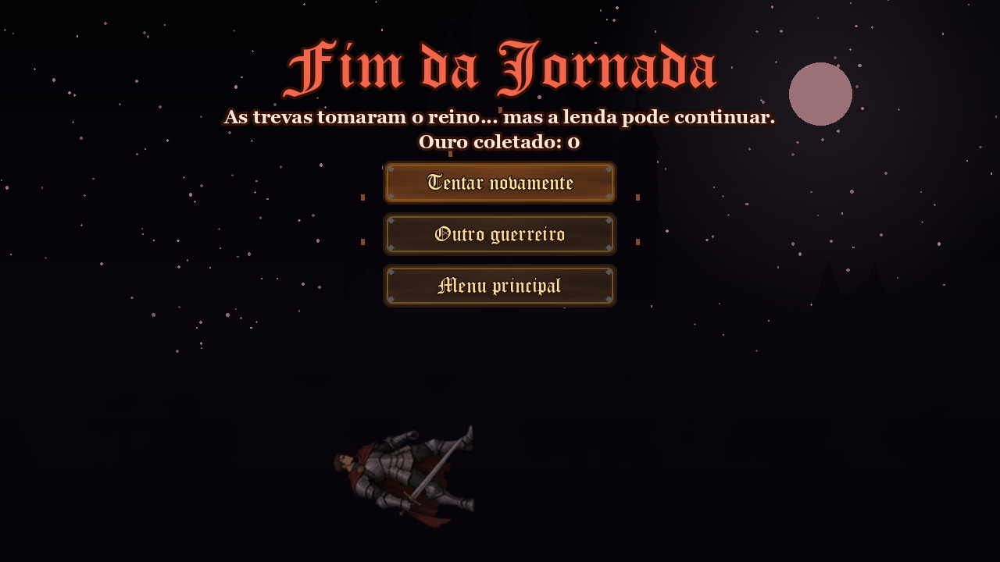 | 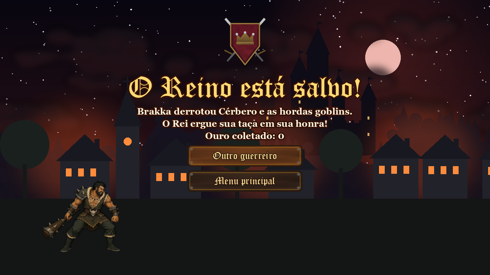 |

---

## 🎨 Direção de arte

### Personagens
Os personagens usam as spritesheets originais pintadas à mão (pastas `cavaleiro/`, `barbaro/`, `goblin */`, `minotauro/`, `cerberus/`, `sabio marcial/`). O script `process_sprites.py` recorta cada frame, alinha todos pelos pés e reduz a resolução para o jogo.

### Animações completadas
As spritesheets não tinham todas as animações necessárias. As que faltavam foram **geradas a partir dos frames existentes** (inclinação, compressão e esticamento, rotação a partir dos pés, balanço do manto, rastro de movimento e rastro do corte pintado nos frames):

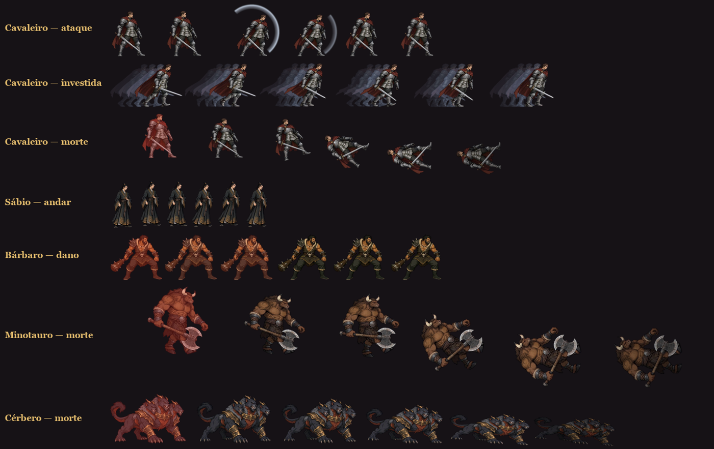

| Personagem | Animações geradas |
|---|---|
| Cavaleiro | ataque 1, ataque 2, investida, pulo, queda, dano, morte |
| Sábio | andar, pulo, queda, dano, morte |
| Bárbaro | pulo, queda, dano |
| Goblin Guerreiro / Lanceiro | parado (respirando), dano, morte |
| Goblin Boleadeiro | dano, morte |
| General Goblin | andar (marcha), morte |
| Minotauro | parado, dano, morte |
| Cérbero | salto (bote), dano, morte (desaba) |

### Assets do reino
Todos os cenários, tiles, objetos e a interface foram **gerados por código** (`tools/gen_kingdom.py`), num tema medieval **sombrio**: paleta dessaturada, sombras frias, contorno escuro e luzes quentes.

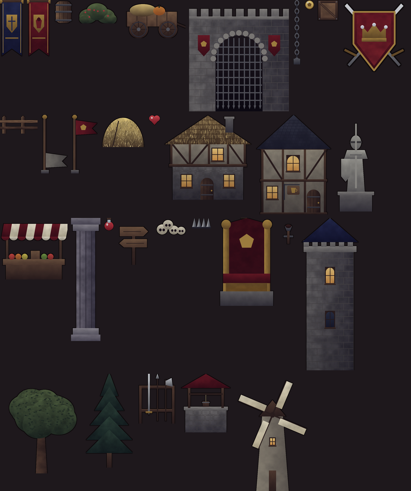

- **Cenários com parallax:** céu de lua de sangue, colinas com castelo em silhueta, aldeia com brilho de incêndio, muralhas com torres, masmorra com arcos e luar.
- **Tiles:** grama/terra, calçamento/muralha, laje/tijolo de masmorra, tábuas, beirais de pedra, água e lava animadas, espinhos.
- **Objetos:** casas de enxaimel (telhado de palha e de ardósia, com placa de taverna), moinho, carroça, banca de mercado, poço, feno, cercas, árvores, torre, portão com grade, estátua de cavaleiro, pilar, correntes, trono, armeiro, caveiras, estandartes (que balançam via shader), tochas.
- **Interface:** painel de couro escuro com detalhes dourados, botões de madeira, brasão, corações, moedas.

### Atmosfera (em tempo real)
- `CanvasModulate` escurece cada fase, e as luzes (`PointLight2D`) de tochas, incêndios, lava, projéteis mágicos e uma luz suave no herói recortam a escuridão.
- `Atmosphere`: brasas e cinzas (fase 1), chuva com relâmpagos e trovão (fase 2), poeira (fase 3).
- Névoa rasteira em parallax na frente da cena e vinheta escura (shader).
- Fogo com partículas de chama, fumaça e fagulhas.

### Áudio
Os efeitos (espada, impacto, metal, pulo, moeda, poção, magia, fogo, pancada no chão, trovão, rugido, fanfarras) e as **5 músicas** em estilo medieval (alaúde sintetizado com bordão, em modo dórico ou menor) são sintetizados por `tools/gen_audio.py`. Os sons do Cérbero são os originais.

| Música | Onde toca |
|---|---|
| `music_title` | Título, seleção, vitória |
| `music_village` | Fase 1 |
| `music_castle` | Fase 2 |
| `music_dungeon` | Fase 3 e derrota |
| `music_boss` | Lutas contra chefes |

---

## 📁 Estrutura do projeto

```
warriors/
├── project.godot              # configuração (1280x720, autoloads Game e Audio)
├── assets/
│   ├── sprites/<personagem>/  # spritesheets otimizadas (+ gen_*.png geradas)
│   ├── kingdom/               # cenários, tiles, objetos e UI do reino
│   └── audio/                 # efeitos e músicas (.wav)
├── scenes/
│   ├── title.tscn  select.tscn  victory.tscn  game_over.tscn
│   └── levels/level_1.tscn  level_2.tscn  level_3.tscn
├── scripts/
│   ├── autoload/game.gd       # estado global, dados dos heróis, fases, input, transições
│   ├── autoload/audio.gd      # efeitos (pool) e música com transição suave
│   ├── hero.gd                # controle do herói, ataques, especiais, vida
│   ├── enemy.gd               # todos os inimigos e chefes (IA por tipo)
│   ├── projectile.gd          # dardos, boleadeiras, orbes, fogo, ondas de choque
│   ├── pickup.gd  fx.gd       # moedas/poções e efeitos visuais
│   ├── char_sprite.gd         # sprite que mantém os pés alinhados e espelha
│   ├── sprite_lib.gd          # monta as animações (SpriteFrames)
│   ├── sprite_meta.gd         # metadados gerados das spritesheets
│   ├── level/                 # level, terrain, hazard, checkpoint, goal,
│   │                          # boss_arena, breakable, torch, fire, atmosphere
│   └── ui/                    # hud, menu, title, select, end_screen
├── shaders/                   # sway (estandartes) e vignette
├── tools/                     # scripts Python de geração (ignorados pelo Godot)
├── docs/screenshots/          # imagens deste README
└── cavaleiro/ barbaro/ ...    # spritesheets ORIGINAIS (com .gdignore)
```

As pastas originais dos personagens têm um `.gdignore` para o Godot não importar as imagens gigantes (até 8000 px de largura). O jogo usa as versões processadas em `assets/sprites/`.

---

## 🧱 Level design no editor

As fases são cenas comuns do Godot e **tudo é editável visualmente**. Os nós usam scripts `@tool`, então aparecem desenhados no editor:

| Nó (grupo na cena) | Script | O que editar no Inspetor |
|---|---|---|
| `Terrain/Ground*`, `Platform*` | `terrain.gd` | `size`, `style` (grama, castelo, masmorra, tábuas, pedra), `one_way`, `safe` |
| `Enemies/*` | `enemy.gd` | `kind` (tipo de inimigo, o sprite muda no editor), `patrol_range`, `start_facing_left`, `dormant` |
| `Items/Breakable*` | `breakable.gd` | `kind` (barril/caixote), `loot` |
| `Items/Coin*`, `Potion*` | `pickup.gd` | posição |
| `Hazards/*` | `hazard.gd` | `kind` (espinhos, água, lava), `width`, `depth` |
| `Checkpoints/*` | `checkpoint.gd` | posição |
| `Decor/Torch*`, `Fire*` | `torch.gd`, `fire.gd` | intensidade e tamanho |
| `Decor/*`, `Foreground/*` | Sprite2D | qualquer textura de `assets/kingdom` |
| `BossArena` | `boss_arena.gd` | `boss_path`, `arena_width` (retângulo vermelho no editor) |
| `Goal` | `goal.gd` | textura e se exige derrotar o chefe |
| Raiz da fase | `level.gd` | nome, subtítulo, música, largura, `ambient` (escuridão), `weather` |

A origem dos blocos de terreno é o canto superior esquerdo (a superfície onde se pisa). Inimigos, objetos e bandeiras têm a origem nos pés.

---

## 🛠️ Ferramentas de geração (pipeline)

Os scripts ficam em `tools/` e precisam de Python 3 com **Pillow** e **NumPy** (`pip install pillow numpy`). Rode a partir da raiz do projeto:

| Ordem | Comando | O que faz |
|---|---|---|
| 1 | `python tools/process_sprites.py` | Recorta e alinha as spritesheets originais para `assets/sprites/` |
| 2 | `python tools/gen_anims.py` | Gera as animações que faltam (`gen_*.png`) e atualiza `sprite_meta.gd` |
| 3 | `python tools/gen_kingdom.py` | Gera todos os assets do reino em `assets/kingdom/` |
| 4 | `python tools/gen_audio.py` | Sintetiza efeitos e músicas em `assets/audio/` |
| 5 | `python tools/build_levels.py` | Gera as 3 fases a partir do design descrito em código |

> ⚠️ **Atenção:** `build_levels.py` **sobrescreve** as fases. Se você editou as fases no editor do Godot, não rode esse script (ou faça backup antes). O passo 1 apaga as animações geradas; rode o passo 2 em seguida.

---

## 📸 Modo de captura (debug)

Todos os prints deste README foram tirados do próprio jogo com um modo de captura embutido em `game.gd`. Os argumentos vêm depois de `--`:

```bash
Godot_v4.7.2-stable_win64_console.exe --path . res://scenes/levels/level_2.tscn -- --hero=cavaleiro --x=7900 --shot=docs/screenshots/chefe2.png --frames=300 --attack
```

| Argumento | Efeito |
|---|---|
| `--hero=<id>` | `cavaleiro`, `barbaro` ou `sabio` |
| `--x=<px>` / `--y=<px>` | Posição inicial do herói (usa o sistema de checkpoint) |
| `--shot=<arquivo.png>` | Salva uma captura de tela (o nome recebe o sufixo `_0`, `_1`...) |
| `--frames=<n>` | Quadros entre capturas |
| `--count=<n>` | Quantidade de capturas |
| `--walk` / `--attack` | Simula andar para a direita e atacar |

Sem esses argumentos, o jogo funciona normalmente.

---

## ⚠️ Limitações conhecidas

- As animações geradas (ataque do cavaleiro, andar do sábio, mortes etc.) são deformações de frames existentes. Funcionam bem em movimento, mas não chegam ao nível de frames desenhados à mão. Se você tiver sprites originais desses movimentos, basta trocar as entradas `gen_*` em `scripts/sprite_lib.gd`.
- A interface usa as fontes do Windows *Old English Text MT* e *Georgia* (via `SystemFont`). Em outros sistemas cai para uma fonte serifada padrão.
- O balanceamento (vida, dano, dificuldade dos chefes) foi ajustado só por testes automáticos. Vale jogar e calibrar os números em `game.gd` (`HEROES`) e `enemy.gd` (`TYPES`).
